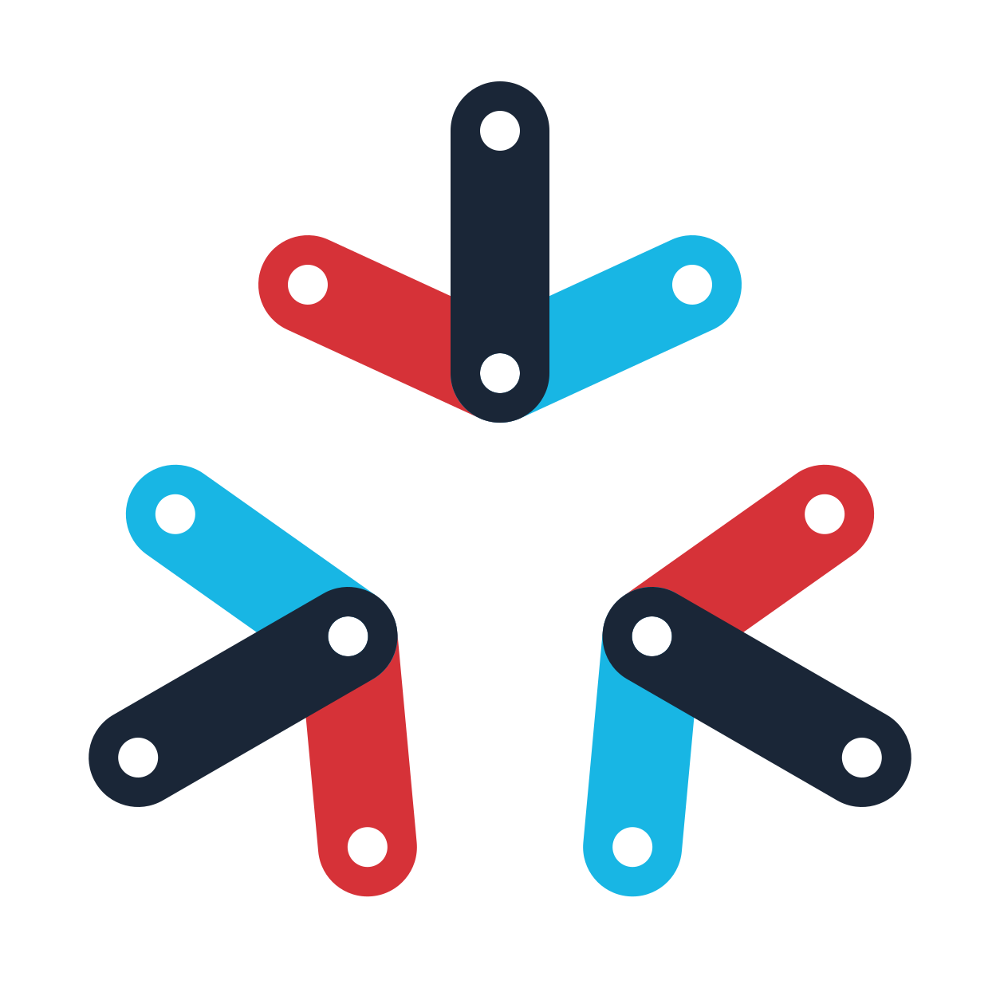
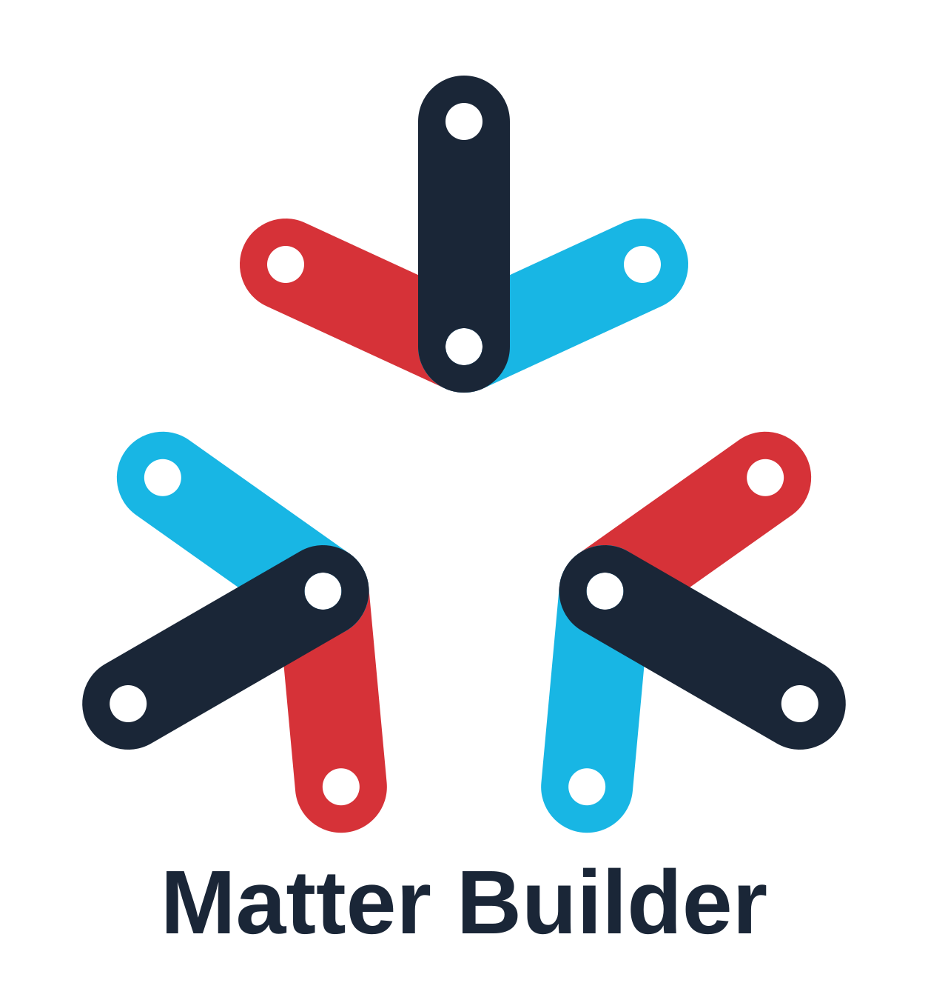
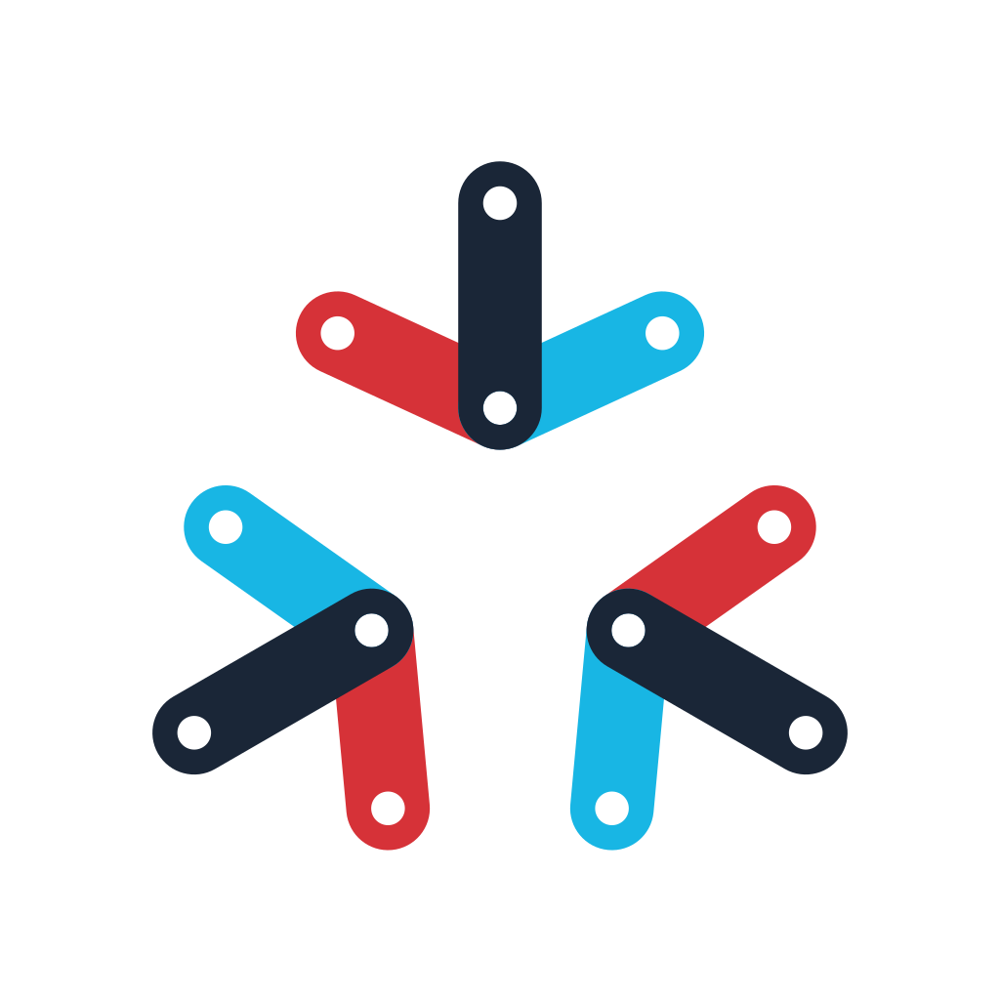
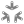

# Matter Builder branding

Copyright © 2026 Bram Boersma. All rights reserved.

Bram Boersma reserves all rights he holds in the Matter Builder artwork below.

| Artwork | Preview | Files |
| --- | --- | --- |
| Red and cyan symbol |  | [SVG](ha-addon/matter_builder/www/matter-builder-rood-cyaan.svg) |
| Logo with wordmark |  | [SVG](ha-addon/matter_builder/www/matter-builder-logo.svg) |
| Transparent app icon |  | [SVG](ha-addon/matter_builder/www/matter-builder-app-icoon-transparant.svg) · [PNG](ha-addon/matter_builder/icon.png) |
| Sidebar icon |  | [SVG](ha-addon/matter_builder/www/matter-builder-zijbalk.svg) |

These assets are excluded from the repository's MIT software license. Except
where permitted by applicable law, reproduction, modification, redistribution
or use of this artwork as branding requires Bram Boersma's prior written
permission. Use in an official Matter Builder release is authorized.

Third-party marks remain the property of their respective owners. Matter
Builder is an independent project and is not affiliated with, endorsed by or
certified by the Connectivity Standards Alliance, Espressif Systems or Home
Assistant.
