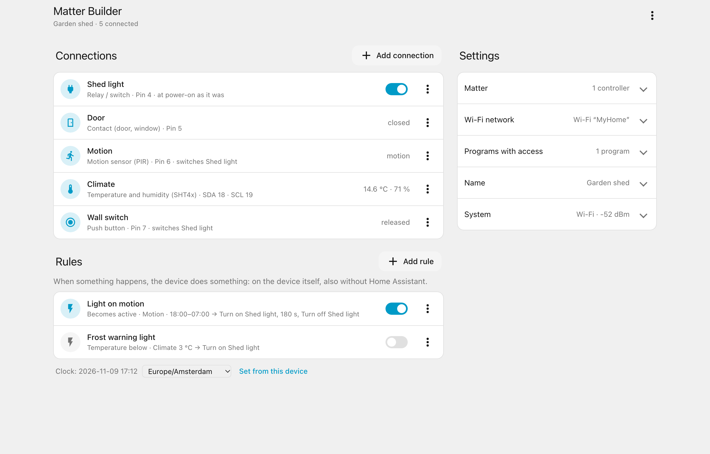
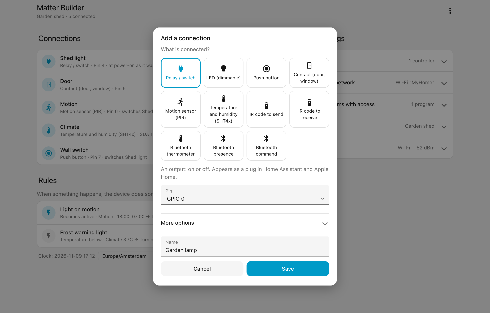
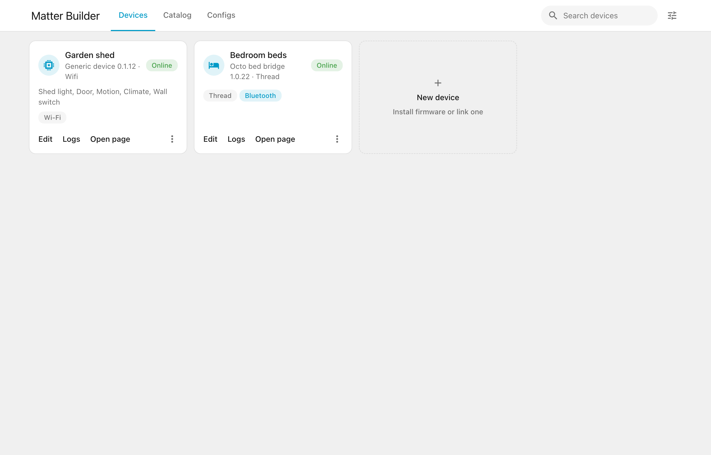
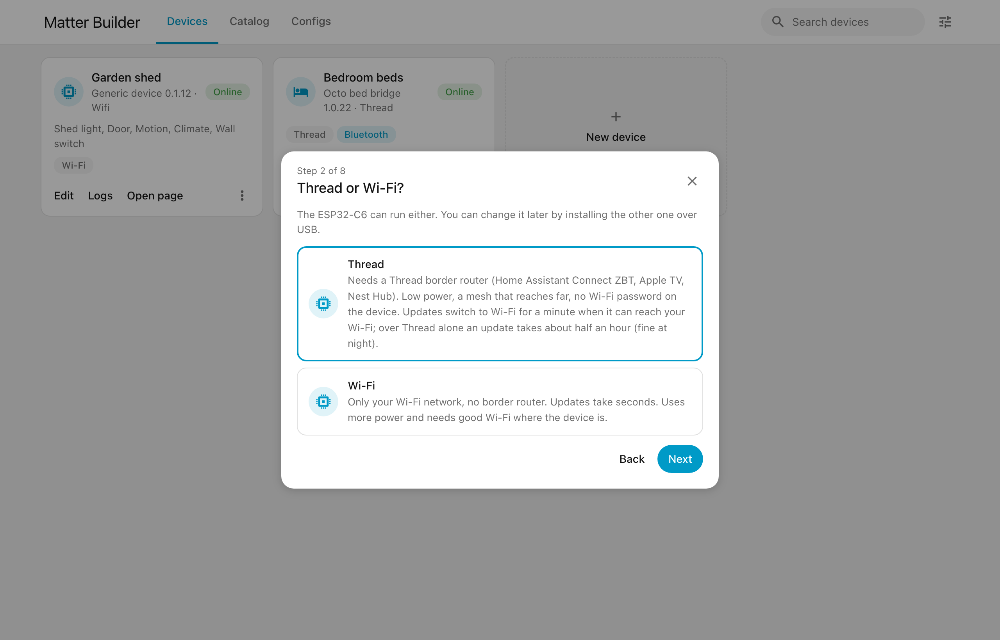
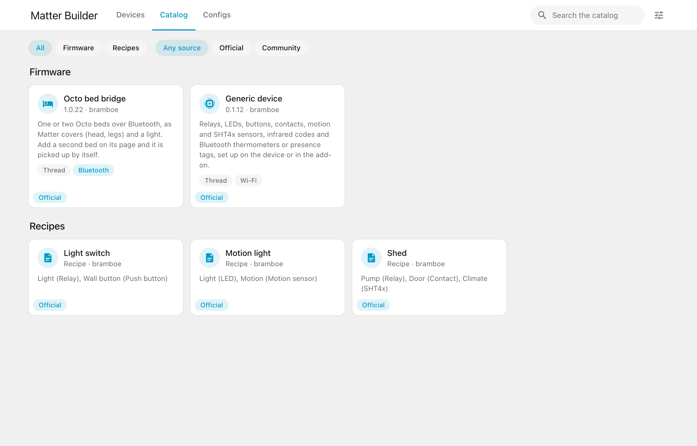
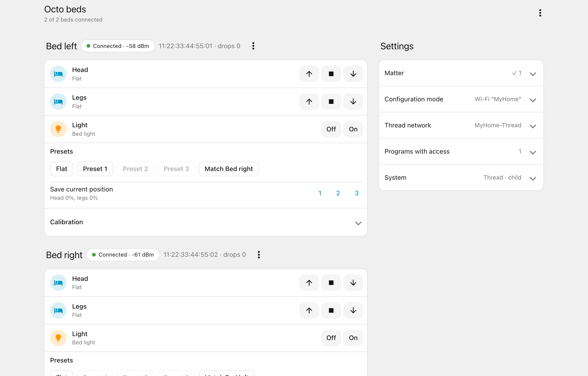
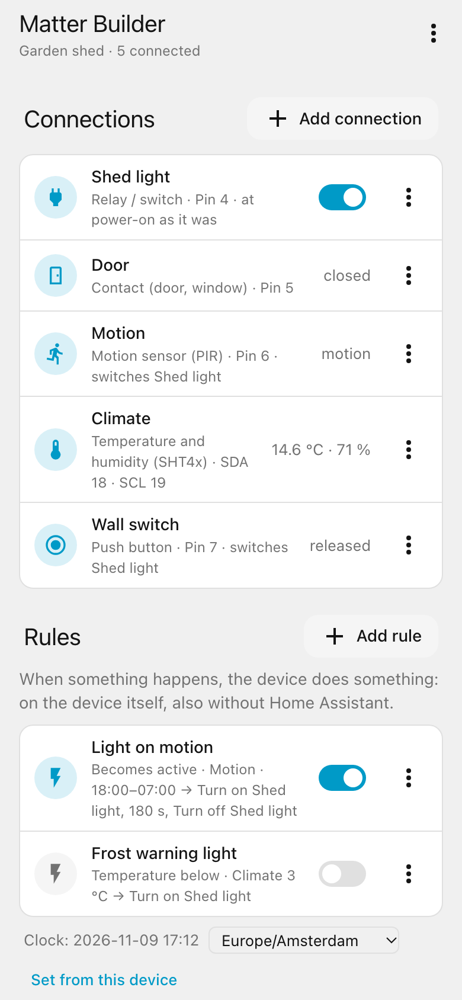

# Matter Builder

[](https://github.com/sponsors/bramboe?frequency=one-time) [](https://bunq.me/bramboe)

ESP32 devices as standard **Matter** devices, over Thread or Wi-Fi: they work
in Home Assistant, Apple Home and Google Home at the same time, and keep
working when Home Assistant is off.

It grows with what you want to do: install ready-made firmware and set it up
in your browser, pick a recipe or package from the catalog, or write a
component of your own and build it in Home Assistant.



- **Ready-made, signed firmware.** Installed and set up from the browser, no
  toolchain involved. The standard firmware, the *generic device*, covers
  relays, LEDs, buttons, contacts, motion and SHT4x sensors on free pins of an
  ESP32-C6 or a classic ESP32, plus infrared (NEC send and receive) and
  Bluetooth LE listening (BTHome v2, pvvx and ATC1441 thermometers, presence
  of a tag).
- **Shows what a device needs.** Every firmware and package states whether
  it needs Thread, Wi-Fi or Bluetooth; the add-on checks it against the board
  before installing.
- **Groups.** Connections that belong together (a lamp and its button) can be
  one device: one accessory in Apple Home, one device in Home Assistant. In
  the add-on by dragging them into a group; on the bed bridge one device per
  bed.
- **Bluetooth devices by recipe.** An ESP32-C6 can send commands to a
  Bluetooth LE device (a bed, a fan, a blind). The commands of a product are
  the same for everyone, so they travel in a recipe; your device's address
  and PIN stay on your device.
- **A catalog anyone can add to.** *Share* puts a configuration in the
  catalog as a recipe, from a repository of your own: nobody approves it.
  Stars are the rating, reports from users take a source out.
- **Network health.** Per device, link by link: its own Thread or Wi-Fi
  connection, the way out through the border router, and the way to Matter
  Builder, with a day of history. When a Thread device drops out, it says
  whether to look at the device or at the border router.
- **Matter pairing over Bluetooth, optional.** Off by default (it costs about
  30 KB of RAM); devices pair with a code over the network instead.
- **Components.** A connection type of your own, linked from a GitHub
  repository or a local folder, built in developer mode.
- **Set up on the device.** Every device has a settings page of its own:
  password, Wi-Fi, Thread network and what is connected. Nothing personal is
  built into the firmware.
- **Matter Builder: in Home Assistant or on its own.** It finds and links
  devices, edits their connections as a form or as YAML, updates them, and
  installs firmware on a new ESP32 over USB. In developer mode it builds
  firmware itself. It runs as a Home Assistant add-on, or without Home
  Assistant in Docker or with Python, with a login of its own.
- **Safe adoption.** Linking a program needs the device's password and a
  press of its BOOT button. Firmware updates are only accepted when they are
  signed; new connections run on trial and are rolled back automatically.

## From a new ESP32 to a working device

1. **Install Matter Builder.** In Home Assistant: add this repository to the
   app store and install *Matter Builder*. Without Home Assistant: see
   [Without Home Assistant](#without-home-assistant).
2. **Plug in the ESP32.** Over USB, into the Home Assistant machine or the
   computer you are working on.
3. **Install the firmware.** In the add-on, *New device*: choose the generic
   device, and on an ESP32-C6 whether it runs on Thread or Wi-Fi. The add-on
   checks the chip and its flash, saves a backup and installs the signed
   firmware.
4. **Set it up.** The ESP32 opens a Wi-Fi network *Matter-Builder-…*. Join it
   with your phone; on the page that opens, choose a password and your Wi-Fi
   (and, for Thread, the Thread network).
5. **Link it.** In the add-on: the device's address and password, then a short
   press of its BOOT button.
6. **Connect things.** Say what is wired to which pin: a relay, an LED, a
   button, a sensor. It starts on trial; keep it, or it goes back by itself.
7. **Add it to Home Assistant.** One click. The same device can join Apple
   Home or Google Home with its pairing code.

From then on the add-on keeps it up to date, at night or when you choose.

### Without Home Assistant

Matter Builder is one program with two ways to run it: as a Home Assistant
add-on, or on its own. Both use the same files and the same version, so they
update together. On its own it has a password of its own instead of Home
Assistant's login; everything else is the same, except *Add to Home
Assistant*.

**Docker** (Linux, e.g. a home server or a Raspberry Pi):

```bash
git clone https://github.com/bramboe/matter-builder && cd matter-builder/standalone
docker compose up -d --build
docker logs matter-builder
```

Open `http://<that machine>:8099` and choose a password. From another computer
the page asks for the setup code from the log, so nobody else on the network
can claim it first. To install over USB on that machine, pass the ESP32's port
in `docker-compose.yml`.

**Python** (macOS, Linux), without Docker:

```bash
git clone https://github.com/bramboe/matter-builder && cd matter-builder
python3 -m pip install zeroconf esptool
sh standalone/run.sh
```

Open `http://localhost:8099`. Plugging the ESP32 into this computer and
installing from the page works in Chrome or Edge. To update Matter Builder,
`git pull` (and in Docker `docker compose up -d --build`).

### Supported ESP32s

| Chip | Network | Flash | What you get |
|---|---|---|---|
| ESP32-C6 | Thread or Wi-Fi, chosen when installing | 8 MB | Everything: relays, LEDs, buttons, contacts, motion, SHT4x, infrared, Bluetooth thermometers, presence and commands, 12 rules that can be Matter switches, pairing over Bluetooth. The Octo bed bridge runs on it (Thread). |
| Classic ESP32 | Wi-Fi | 4 MB | Relays, LEDs, buttons, contacts, motion, SHT4x and infrared, and rules (2 of them as Matter switches). No Bluetooth connections: its memory is too small next to Matter. |
| ESP32-S3, C3, H2 | | | Not yet. |

Updates go over Wi-Fi in a minute or two; a Thread device switches to Wi-Fi
for that moment when it can reach it, otherwise the update goes over Thread
(about half an hour, fine at night).

### Why this way

- **One device, every smart home.** Matter is a standard: the device works in
  Home Assistant, Apple Home and Google Home at the same time.
- **Fully standalone once installed.** Its connections and rules run on the
  device itself: it needs no Home Assistant at all, and no internet. Set it up
  on its own page, pair it straight with Apple Home or Google Home, or use it
  with nothing else; when Home Assistant is there, it is one more controller.
- **No code, no toolchain.** You set a device up in a form; firmware comes
  ready-made and signed.
- **Nothing personal in the firmware.** Passwords and networks are set on the
  device, so one firmware fits everyone and can be shared.
- **Safe to change.** New connections run on trial, updates are checked
  against their signature, and a device that fails to start goes back to its
  previous firmware.
- **Thread or Wi-Fi.** Thread for low power and range through a mesh, Wi-Fi
  when there is no Thread network; on the C6 you choose.

### Screenshots

<table>
  <tr>
    <td width="50%"><br><sub>Adding a connection on the device's page</sub></td>
    <td width="50%"><br><sub>The add-on: linked devices</sub></td>
  </tr>
  <tr>
    <td><br><sub>Installing firmware on a new ESP32</sub></td>
    <td><br><sub>The catalog: firmware and recipes</sub></td>
  </tr>
  <tr>
    <td><br><sub>The Octo bed bridge</sub></td>
    <td align="center"><br><sub>The device's page on a phone</sub></td>
  </tr>
</table>

<sub>Screenshots with demo data.</sub>

## Layers

| Layer | What | Built by |
|---|---|---|
| Standard firmware (`generic`) | General building blocks, configured on the device | The project, released signed |
| Packages | Firmware with code of its own (e.g. a Bluetooth protocol); the official source has the Octo bed bridge | Its source, released signed |
| Developer mode | Your own code | You, in Home Assistant |

See [docs/matter-builder-design.md](docs/matter-builder-design.md) for the
design, including package sources and the catalog.

## Repository

| Path | Contents |
|---|---|
| `components/mb_core` | Shared core: Matter and Thread setup, settings page API, adoption, OTA, configuration mode, boot guard |
| `firmware/generic` | The generic device (ESP32-C6 on Thread or Wi-Fi, classic ESP32 on Wi-Fi; esp-matter release/v1.6) |
| `firmware/bridge`, `components/octo_*` | The Octo bed bridge package: two Octo beds over Bluetooth ([README](firmware/bridge/README.md)) |
| `ha-addon/matter_builder` | Matter Builder: the Home Assistant add-on, which also runs on its own |
| `standalone/` | Running Matter Builder without Home Assistant: Docker Compose and a start script |
| `tools/mb_generate.py` | Turns a device spec (YAML) into a project |
| `tools/release_manifest.py` | Writes and signs a release manifest |
| `examples/` | Example device specs, and `examples/components/` (a component: a connection type of its own) |
| `components/mb_driver` | The interface for components |
| `.github/workflows/release.yml` | Builds and signs a release for a tag `v*` |
| `.github/workflows/catalog.yml`, `tools/build_catalog.py`, `catalog/` | The catalog of package sources on GitHub Pages, with the block and verified lists |
| `template/` | Start of a package source of your own |
| `matter-builder-key.pem` | The project's public key (the add-on ships the same one) |

## Building

Needs ESP-IDF v5.5.5 (`~/esp/esp-idf-v5.5.5`, `install.sh esp32c6`) and
esp-matter `release/v1.6` at commit `fe1efc6c` (`~/esp/esp-matter`):

```sh
. ~/esp/esp-idf-v5.5.5/export.sh && . ~/esp/esp-matter/export.sh
cd firmware/generic
idf.py -B build -D SDKCONFIG=build/sdkconfig -D IDF_TARGET=esp32c6 build
```

The add-on's developer mode does the same with the same versions
(`ha-addon/matter_builder/toolchain.sh` and `build.sh`).

## Releases

A tag `v<version>` builds the generic device and the Octo bed bridge in GitHub Actions, writes
`manifest.json` with the SHA-256 of every image and signs it with ECDSA P-256
(secret `MB_SIGNING_KEY`). The add-on checks the signature against
`ha-addon/matter_builder/release-key.pem` and every image against its hash
before it installs anything.

## Status

| Part | State |
|---|---|
| Generic device 0.1.3 (released) | Tested on an ESP32-C6: setup access point, linking, connections with trial and rollback, IR send, Bluetooth presence next to Thread |
| Generic device 0.1.12 (C6 Thread or Wi-Fi, classic ESP32 4 MB), Octo bridge 1.0.22 (released) | Tested on an ESP32-C6: pairing over Bluetooth (stable with two controllers and Bluetooth presence next to it; 174 KB free with pairing on, 199 KB off), components build; the bed bridge added to Home Assistant with both beds, its number of beds changed from the add-on |
| Add-on 0.26.1 | Devices, Catalog and Configs tabs; visual and YAML editor; settings form per firmware; flashing on the Home Assistant host; adding a device to Home Assistant; updates over Thread when Wi-Fi is out of reach |
| Matter Builder 0.27.0 on its own | Without Home Assistant (Python on macOS tested: own login, setup code from another computer, sign out, lockout after 5 wrong passwords, discovery); Docker build and start tested in CI |
| Network health (add-on 0.28.0) | Thread and Wi-Fi diagnosis per link with a day of history; verdicts tested on recorded scenarios, the page against mock devices; the firmware side is in the next release |
| Generic 0.1.13, Octo bridge 1.0.23, add-on 0.29.0 | Groups (connections as one device; one device per bed) and network health; built for all four targets, the editor tested against mock devices; not yet on hardware |
| Octo bridge 1.0.24, add-on 0.30.0 | On hardware: one device per bed in Home Assistant next to Apple Home, parts named by the add-on; groups on a classic ESP32; network health found a weak Thread link. The Bluetooth device editor is tested against mock devices only |
| Catalog | Built nightly on GitHub Pages from repositories with the topic `matter-builder-package` |

## License

MIT
